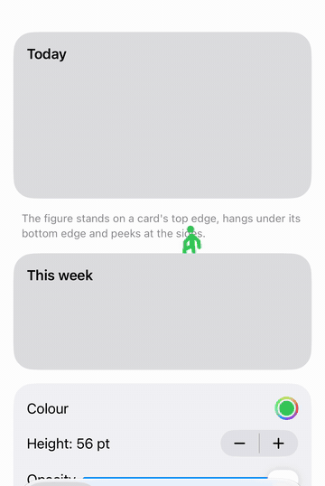

# EdgeBuddy

[](https://github.com/Jojogurt/EdgeBuddy/actions/workflows/ci.yml)
[](https://swiftpackageindex.com/Jojogurt/EdgeBuddy)
[](LICENSE)

A tiny stick figure that lives on the edges of your SwiftUI cards.

<p align="center"></p>

EdgeBuddy adds one small, single-colour figure to a screen. It comes out from
behind a card you mark, plays a short random action, goes back and comes out
somewhere else:

- **top edge** — stands on it: rests, waves, does jumping jacks, stretches,
  marches, inches along it like a caterpillar (worm walk), cartwheels into a
  handstand or runs along the edge;
- **bottom edge** — hangs under it (wide grip): swings like a pendulum, pulls
  itself up;
- **leading / trailing edge** — slides out from behind the card and plays
  beside it, outside its edge, holding on: hangs out and looks around, does a
  human flag (hands wide apart on the edge, body held out flat), climbs up the
  edge hand over hand (the flag and the climb come out hands first, straight
  into the action) (only where enough of the side is on screen). Nothing
  plays over the card. A side less than ~28 pt from the screen's edge (a
  full-width card, the outer side of a tile) has no room beside it and only
  climbs there — the figure may be cut by the screen's edge; a side facing
  other content (the inner side of a tile in an `HStack`) gets everything,
  even if the figure overlaps the neighbour.

A tap sends it to another card. It never plays the same action twice in a
row (nor the same edge of the same card) while there is something else to do. It rides along while the content scrolls and
waits for the scroll to stop before coming out again.

## Requirements

- iOS 18+ (also builds for macOS 15+)
- Swift 6 (strict concurrency), Xcode 16+

## Installation

Swift Package Manager — in Xcode: **File › Add Package Dependencies…** and
enter the URL, or in `Package.swift`:

```swift
dependencies: [
    .package(url: "https://github.com/Jojogurt/EdgeBuddy.git", from: "0.3.3"),
],
targets: [
    .target(name: "MyApp", dependencies: ["EdgeBuddy"]),
]
```

XcodeGen (`project.yml`):

```yaml
packages:
  EdgeBuddy:
    url: https://github.com/Jojogurt/EdgeBuddy.git
    from: 0.3.3
```

## Quick start

### A screen with several cards

Put one stage on the screen's `ScrollView` and mark the cards the figure may
come out from behind:

```swift
import EdgeBuddy
import SwiftUI

struct TodayScreen: View {
    var body: some View {
        ScrollView {
            VStack(spacing: 16) {
                HeroCard()
                    .figureAnchor("hero", edges: .all)
                StatsCard()
                    .figureAnchor("stats")                 // top only
                ForEach(items) { item in
                    ItemCard(item)
                        .figureAnchor(item.id, edges: [.top, .trailing])
                }
            }
            .padding()
        }
        .figureStage()
    }
}
```

- Anchor ids must be unique among the stage's anchors.
- Anchors take no space and change nothing without a stage.
- The figure stands *above* a card's top edge — leave some room above the
  first card (about the figure's height, 56 pt by default).

### A single card

For one-off cards (onboarding, empty states) there is no stage to set up:

```swift
EmptyStateCard()
    .peekingFigure()
```

It comes out at the card's top edge only. It takes no space: where the card
is the first thing in a scroll view, leave room above it or use
`scrollClipDisabled()`.

### Holding the stage

While something else needs the screen (a celebration, a sheet animating in),
pass `isWaiting: true`; the figure stays where it is and carries on afterwards:

```swift
.figureStage(isWaiting: isCelebrating)
```

`loops: false` makes it come out once and stand; `isEnabled: false` removes it.

## Edges and weights

`figureAnchor(_:edges:)` takes a `FigureEdges` set: `.top` (default),
`.bottom`, `.leading`, `.trailing` or `.all`. Each cycle the stage picks a
random anchor that is fully on screen (never the same one twice in a row when
there is another), then an edge of it, evenly:

| Edge | Weight | Needs |
|---|---|---|
| top | 25 % | ~108 pt wide; room above the card on screen |
| bottom | 25 % | ~108 pt wide; room under the card on screen |
| leading / trailing | 25 % each | that edge on screen and ~82 pt of the card's height (~136 pt at the screen's edge, where it only climbs) |

Weights are renormalized over the edges that are possible right now. Some
actions need more room: the climb needs ~136 pt of the side on screen (it
climbs at least ~54 pt, always to the top of the visible side), the worm walk ~33 pt of free width on one side of
it; elsewhere the edge simply plays its other actions. Sizes scale with
`figureHeight(_:)`.

## Customization

All settings are environment values — set them on the stage or anywhere
above it (for example once at your app's root):

```swift
.figureStage(style: FigureStyle(entrance: .spring, tempo: 1.2, appearDelay: 0.8...2))
.figureColor(.accentColor)      // single colour; dynamic colours follow dark mode
.figureOpacity(0.8)             // softer on the cards; 1 by default
.figureHeight(56)               // points; everything else scales from it
.figureHaptics(true)            // selection haptic on tap
.figureMotionEnabled(nil)       // nil = built-in policy, or your app's own Bool
```

- **Colour** — default `Color.accentColor`.
- **Opacity** — `figureOpacity(_:)`, 0…1, default 1 (say 0.8 to sit softer
  on the cards).
- **Size** — default 56 pt (the height above a top edge). Width, margins and
  the footprint at the other edges scale with it.
- **Haptics** — `.sensoryFeedback(.selection)` on tap, on by default.
- **Character** — `figureCharacter(_:)`: `HumanFigure` with its look, or a
  character of your own (below).
- **Motion** — the built-in policy lets the figure loop only while the scene
  is active and Reduce Motion and Low Power Mode are off. If your app has its
  own idle-motion setting, pass it with `figureMotionEnabled(_:)`; it replaces
  the built-in policy (Reduce Motion and Low Power Mode still stop the loop).
- **Style** — `FigureEntrance.climb` (default: grabs the edge and climbs up)
  or `.spring` (pops straight up); `tempo` scales the speed; `appearDelay`
  (default 1.5…3 s, drawn at random, scaled by tempo) keeps it hidden for a
  moment after the screen appears before its first entrance — `0...0` comes
  out at once. Later cycles and taps don't wait.

### Look and custom figures

`figureCharacter(_:)` picks who plays. The default is `HumanFigure`, the
stick figure above; its parameters change how it is drawn, not what it does:

```swift
.figureCharacter(HumanFigure(head: .text("🐻"), headScale: 1.4, armColor: .orange))
```

`HumanFigure` takes the head (`.circle`, `.symbol("star.fill")`, `.text("🐻")`
or `.image(…)`), a size for head, limbs and torso (0.6…1.5), a colour per part
(nil = `figureColor`) and `mirrorsHead`.

For a different figure altogether — say a ghost with no arms or legs —
write a type conforming to `FigureCharacter`. It brings its own pose model,
its actions per edge, the room it needs and its drawing; the stage keeps
picking cards, edges and spots, sequencing each play (out from behind the
card, a hold, the action, back), taps, Reduce Motion, Low Power Mode and pins:

```swift
struct Ghost: FigureCharacter {
    struct Pose: FigureCharacterPose {           // whatever one frame needs
        var y: Double, sway: Double
        func interpolated(to other: Pose, _ t: Double) -> Pose {
            Pose(y: y + (other.y - y) * t, sway: sway + (other.sway - sway) * t)
        }
    }

    // Its own units: a 64 × 64 box above a top edge (the card's edge at y 64),
    // 48 × 72 beside a side (the card's edge at x 0, drawn as the trailing side).
    func box(at edge: FigureEdge) -> FigureCharacterBox {
        edge == .top ? FigureCharacterBox(CGRect(x: 0, y: 0, width: 64, height: 64), edge: 64)
                     : FigureCharacterBox(CGRect(x: 0, y: 0, width: 48, height: 72), edge: 0)
    }

    func actions(at edge: FigureEdge) -> [FigureCharacterAction<Pose>] {
        guard edge == .top else { return [] }   // no actions = never at that edge
        let rest = restPose(at: edge)
        return [
            FigureCharacterAction("float", motion: FigureMotion(duration: 1.4, through: [
                rest, Pose(y: 34, sway: 0), rest,
            ]), repeats: 2...3),
            FigureCharacterAction("drift", motion: FigureMotion(duration: 0.9) { t in
                Pose(y: 40, sway: 10 * sin(.pi * t / 0.9))
            }, repeats: 2...4, travel: 22),         // moves 22 units along the edge per beat
        ]
    }

    func restPose(at edge: FigureEdge) -> Pose { Pose(y: 40, sway: 0) }
    func hiddenPose(at edge: FigureEdge) -> Pose { Pose(y: 106, sway: 0) }  // behind the card

    func draw(_ pose: Pose, in context: inout GraphicsContext, color: Color) {
        // draw with `context` in the box's units
    }
}

ScrollView { … }
    .figureStage()
    .figureCharacter(Ghost())
```

- `box(at:)` — per edge, the part of the character's space that is drawn
  (and tappable) and where the card's edge runs through it. `referenceHeight`
  (default: the top box above its edge) is what `figureHeight(_:)` sets in
  points; widths, margins and the narrowest card it uses follow the boxes.
- `actions(at:)` — one beat of `FigureMotion` (`pose(at:)` over a duration,
  or `through:` a few poses), repeated `repeats` times, optionally travelling
  along the edge (`travel`; a side's travelling action goes up to the top),
  `hold` for pins, `playsAtScreenEdge`. An empty list means the edge is never used.
- `restPose(at:)` / `hiddenPose(at:)` and `entrance(at:)` — by default it
  rises from the hidden pose to the rest pose and sinks back the same way.
- `draw` and `pose(at:)` run on every frame: keep them cheap.

Pin a character's action by name: `FigurePin(anchor: "hero", action: "float")`.
`Examples/EdgeBuddyDemo/Sources/Ghost.swift` is a complete ghost (float, sway,
boo and drift on the top; peek, boo and haunt at the sides; never under a card).

### Running figure

`RunningFigure` is the human figure in profile, running in place — handy for a
loading indicator (`figure:` takes a `HumanFigure` for its look):

```swift
TimelineView(.animation) { context in
    RunningFigure(
        phase: context.date.timeIntervalSinceReferenceDate / RunningFigure.cycleDuration,
        color: .green
    )
}
.frame(width: 54, height: 56)
.accessibilityLabel("Loading")
```

## Snapshots & previews

For App Store screenshots, Xcode previews and snapshot tests the figure has
to stand still in a known place. Pin it:

```swift
ScrollView { … }
    .figureStage()
    .figurePinned(FigurePin(anchor: "hero", edge: .trailing, pose: .flag))
```

With a pin the stage skips the entrance delay and every random pick: the
figure comes out at that edge of that anchor (whatever edges the anchor
allows), plays the pose and freezes at its hold frame. It never loops,
ignores taps, and holds the frame also under Reduce Motion, in Low Power Mode
and with idle motion off. Pass `animated: false` to show the hold frame at
once, without the entrance — the steadiest choice for snapshots — and `spot`
(0…1, default 0.5) to move it along the edge.

`FigurePose` lists the poses with a clear still frame: `.rest` (every edge),
`.wave`, `.jumpingJacks`, `.sideStretch`, `.march`, `.handstand` (top),
`.swing`, `.pullUp` (bottom), `.peek`, `.flag` (sides). A pose pinned at an
edge it isn't played at rests there. If the anchor is not on screen or the
figure doesn't fit at that edge, the stage plays as without a pin and takes
the pin up as soon as it fits. `figurePinned(nil)` lets it play freely again.
For a single card (`peekingFigure`) use
`.figurePinned(.singleCard(pose: .wave))` — its anchor has no id of yours.
`FigurePose` is the `HumanFigure`'s list; for a character of your own pin an
action by name, `FigurePin(anchor: "hero", action: "float")` (an action it
doesn't play at that edge rests; an edge it never uses falls back to the free stage).

## Accessibility

- The figure is decoration: hidden from VoiceOver, and it never takes taps
  meant for the content under it (only the figure itself is tappable, and only
  once it is out).
- Hidden at accessibility text sizes (AX1 and larger), where it would cover
  too much of the larger text.
- Reduce Motion: no loop, no tap relocation — it fades in and stands.
- Low Power Mode: no loop and no actions — it comes out once and rests.
- It stops while the scene is not active and its clock stops while it is off
  screen or holding still.

## Limitations

- Not in `List` or `Form`: their rows are recycled and clipped, so anchors
  inside them are unreliable. Use a `ScrollView` with a lazy or plain stack.
- One stage per screen. Anchors belong to the nearest stage above them.
- In lazy stacks, cards far off screen have no frame; the figure simply uses
  the ones that are laid out.

## Example

`Examples/EdgeBuddyDemo` is a multiplatform (iOS + macOS) demo app with four tabs — Playground, Pinning, Static and Single card. Open `Examples/EdgeBuddyDemo/EdgeBuddyDemo.xcodeproj` in Xcode and run; see its README.

## License

MIT — see [LICENSE](LICENSE).
